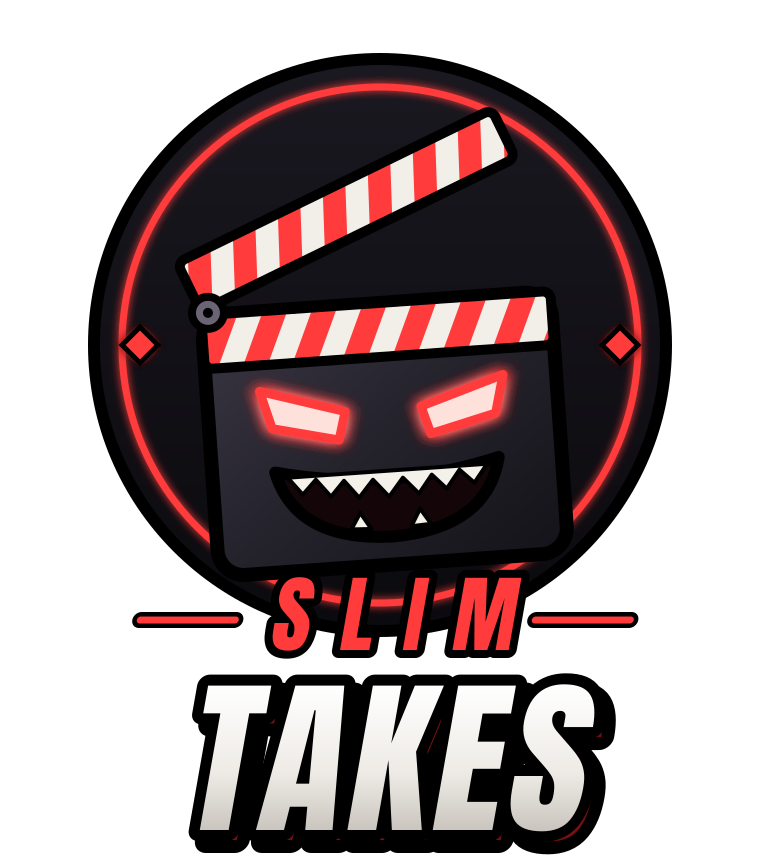
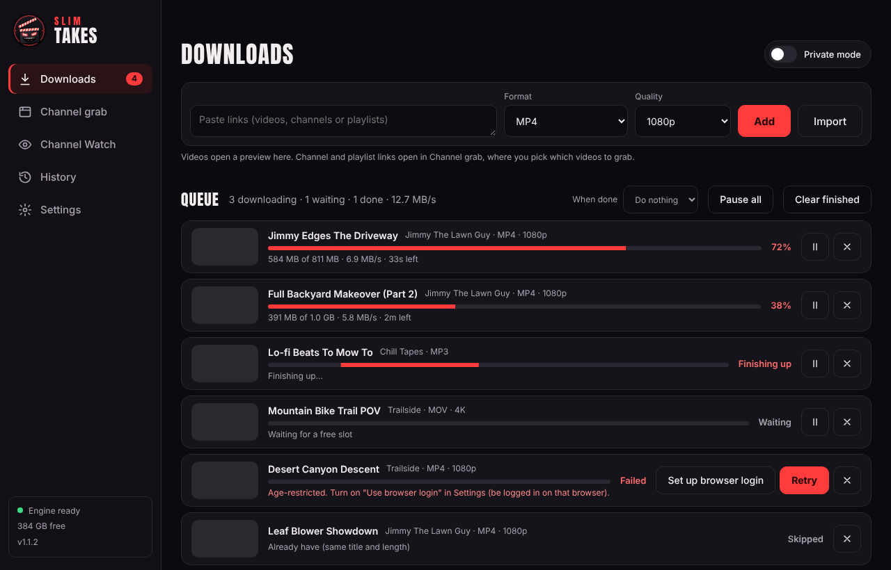

# Slim Takes

**Download videos and audio from YouTube and 1,000+ other sites.** Free, no daily limits, no playlist limits, no ads.

Works with YouTube, Vimeo, Twitch, TikTok, Instagram, X (Twitter), Reddit, Facebook, Dailymotion, SoundCloud, Bandcamp and many more.

## Features

- **Paste and go** — one box for everything: paste one link or a whole list, or drop links onto the window
- **Whole channels and playlists** — see every video first, untick what you don't want, see the total size before starting
- **Page scan** — for channel pages the engine can't read, Slim Takes reads the page itself
- **Channel Watch** — follow channels; new uploads download automatically
- **Any format** — MP4, MKV, MOV, WebM, AVI, or audio as MP3, M4A, FLAC, WAV or Opus
- **Pick the quality** — 1080p by default, up to 4K, or anything lower
- **Trim** — grab just part of a video
- **Tidy files** — every file is named after the video title, in one folder per creator, dated by upload date
- **Stays in sync** — delete a video in File Explorer and it disappears from the app too
- **No duplicates** — videos you already have are skipped; different videos with the same title are kept as "Title (2)"
- **Skip sponsor segments** on YouTube (SponsorBlock)
- **Queue** — pause, resume, retry, speed limit, and sleep or shut down the PC when everything's done
- **Privacy** — Private mode, PIN lock, optional blurred thumbnails
- **Notifications** — Windows notifications and optional Discord pings
- **Themes** — six built-in colour themes plus your own

## Download

Grab the latest `SlimTakes-x.x.x-portable.exe` from [Releases](../../releases). No install needed — just run it.
On first launch Slim Takes downloads its free helper programs (yt-dlp, ffmpeg and Deno, about 250 MB) and keeps them updated.

## Please download responsibly

Only download videos you have the right to save — your own uploads, Creative Commons content, or anything the owner allows.
Respect each site's terms of service.

## Credits

Slim Takes is a front end for these excellent free projects:
[yt-dlp](https://github.com/yt-dlp/yt-dlp) · [FFmpeg](https://ffmpeg.org) · [Deno](https://deno.com) · [SponsorBlock](https://sponsor.ajay.app)

© 2026 **Slim Industries**. All rights reserved. Free to download and use; see [LICENSE](LICENSE).
